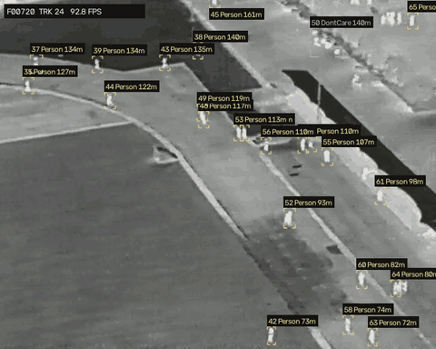
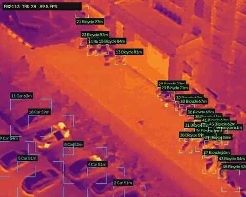
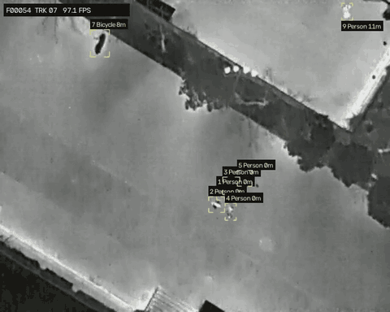
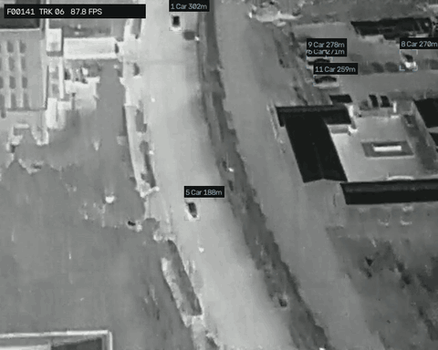

# SKY-IR: High-Altitude Infrared Thermal Object Tracking for UAV


Hệ thống phát hiện và theo dõi đa đối tượng (người, ô tô, xe đạp…) trên video nhiệt/hồng ngoại quay từ UAV ở độ cao 60–130 m:
- **Phát hiện:** YOLOv8 với backbone EfficientNet-B0, chạy bằng TensorRT FP16.
- **Theo dõi:** **SkyTrack**, thuộc họ ByteTrack/BoT-SORT, tinh chỉnh cho mục tiêu chỉ vài pixel, có bù chuyển động camera.
- **Cự ly:** ước lượng khoảng cách mặt đất từ độ cao, góc nghiêng camera và tiêu cự.
- **Giao diện:** web xử lý thời gian thực.

## Kết quả

Các đoạn dưới đây là đầu ra thật của pipeline trên video mẫu (overlay được xuất bằng chức năng *Export*; GIF phát nhanh gấp 2 lần video gốc 7.5 FPS).
Nhãn trên mỗi đối tượng gồm `ID`, lớp và cự ly mặt đất; góc trên trái hiển thị số frame, số track và tốc độ xử lý.

| Người đi bộ: độ cao 60 m, camera nghiêng 30° | Ô tô và xe đạp: 60 m, 40° (bảng màu Ironbow) |
|:---:|:---:|
|  |  |
| **Nhìn thẳng xuống: 70 m, 90°** | **Độ cao lớn: 120 m, 30°** |
|  |  |

### Hiệu năng

Đo trên RTX 3050 Laptop (4 GB), video 640×512 (`backend/scripts/benchmark.py`):

| | Phiên bản cũ | Hiện tại |
|---|---|---|
| Inference model | 29.1 ms (PyTorch FP32) | **8.6 ms** (TensorRT FP16, tiền/hậu xử lý trên GPU) |
| Toàn pipeline (decode → detect → GMC → track) | 27 FPS | **103 FPS** |
| Máy không có TensorRT (PyTorch FP16) | – | 54 FPS |
| Xuất video | mp4v, encode lại lần 2 | H.264 trực tiếp, ~85 FPS |

### Chất lượng tracking

So sánh với tracker cũ trên 5 video mẫu, cùng một bộ detection (`backend/scripts/eval_tracker.py`).
Chưa có ground truth nên dùng chỉ số thay thế; có file GT định dạng MOT thì tải lên ở mục *Export* để có MOTA / IDF1 / ID switch thật.

| | Tracker cũ (SORT + IoU) | SkyTrack |
|---|---|---|
| Số ID tạo ra (ít hơn = ít phân mảnh) | 236 | **204** |
| ID mới mọc ngay chỗ ID cũ vừa mất (≈ đổi ID) | 29 | **7** |
| Độ phủ detection tin cậy cao | 94.7 % | **97.1 %** |

## Tính năng

**Phát hiện và theo dõi**
- Bù chuyển động camera (GMC): optical flow + RANSAC. Phép biến đổi áp dụng cho cả vị trí, kích thước, vận tốc và hiệp phương sai của Kalman filter.
- Ghép bằng *buffered IoU* (C-BIoU) kết hợp khoảng cách tâm: mục tiêu 8 px dịch 9 px giữa 2 frame có IoU = 0, nhưng vẫn ghép đúng.
- Ghép 3 tầng kiểu ByteTrack; track bị mất được nối lại trong `track_buffer` giây.
- Lớp đối tượng được bầu theo độ tin cậy, chống nhảy lớp Person/Bicycle ở mục tiêu nhỏ.
- Khoá mục tiêu ở bất kỳ frame nào. Mục tiêu đã khoá được giữ lâu hơn và hiển thị vị trí dự đoán khi tạm mất dấu.

**Giao diện web**
- Stream thời gian thực qua WebSocket. Overlay vẽ trên canvas phía trình duyệt nên đổi kiểu hiển thị tức thì.
- Bấm vào đối tượng để khoá/bỏ khoá. Ô phóng to mục tiêu nhỏ. Vệt di chuyển bám mặt đất, đã bù chuyển động camera.
- Chỉnh ngưỡng detect/track, lọc lớp, tham số camera ngay khi video đang chạy.
- Bảng màu nhiệt: White-hot, Black-hot, Ironbow, Arctic, Rainbow.
- Bảng đối tượng (lớp, độ tin cậy, cự ly, tuổi track) và bảng thời gian từng giai đoạn xử lý.
- Xuất MP4 (H.264) có overlay, `tracks.txt` định dạng MOT và metrics nếu có ground truth.
- Tự điền độ cao/pitch từ tên file kiểu `60m-40_3.mov` (60 m, 40°).
- Phím tắt: `Space` phát/dừng · `→` frame kế tiếp · `R` chạy lại · `Esc` bỏ khoá.

## Kiến trúc

```text
Video ──► FrameReader (thread prefetch)
             │
             ├──► TensorRT detector (GPU) ──┐
             └──► GMC optical flow (CPU) ───┴──► SkyTrack ──► cự ly ──► WebSocket ──► React UI (canvas)
                                                                    └──► Export: H.264 + MOT + metrics
```

```text
backend/
  skyir/
    detector.py        TensorRT runner + PyTorch fallback, tự build engine
    pipeline.py        Session: decode, detect ‖ GMC, track, cự ly
    tracker/           SkyTrack: kalman.py, matching.py, gmc.py, tracker.py
    distance.py        Ước lượng cự ly mặt đất / đường chéo
    export.py          Xuất H.264, tracks MOT, MOTA/IDF1
    render.py          Vẽ overlay cho video xuất
    server.py          FastAPI: REST + WebSocket /api/stream
  scripts/
    benchmark.py       Đo tốc độ các backend
    eval_tracker.py    So sánh tracker cũ và mới
    legacy/            Tracker cũ (giữ làm baseline)
  tests/               Unit test tracker
frontend/              React + TypeScript + Vite
models/                Trọng số .pt (engine .engine sinh tự động)
asset/                 Hình minh hoạ cho README
.github/               CI, CODEOWNERS, PR template
run.sh                 Chạy / dev / test
```

## Cài đặt

```bash
git clone https://github.com/Astrq23/SKY-IR.git && cd SKY-IR

# Python 3.10–3.12
python -m venv .venv && source .venv/bin/activate
pip install torch torchvision --index-url https://download.pytorch.org/whl/cu128
pip install -r requirements.txt

# Frontend (Node 18+)
cd frontend && npm install && cd ..
```

Tải trọng số vào `models/`: https://drive.google.com/drive/folders/1u7Ez44U2t3bCcb2YwpMhcN_xASYZbMUV?usp=sharing

Video mẫu đặt trong `models/` hoặc `data/samples/`; cũng có thể tải video lên trực tiếp trên giao diện.

## Chạy

```bash
./run.sh            # build UI nếu cần, mở http://127.0.0.1:8000
./run.sh dev        # backend :8000 + Vite hot-reload :5173
./run.sh test       # unit test

HOST=0.0.0.0 ./run.sh   # cho máy khác trong mạng LAN truy cập
```

- Lần chạy đầu sẽ build TensorRT engine (~2–3 phút).
- Engine phụ thuộc GPU và phiên bản TensorRT; khi đổi máy chỉ cần xoá file `.engine` để build lại.
- Không có TensorRT thì hệ thống tự dùng PyTorch FP16.

Đo đạc:

```bash
python backend/scripts/benchmark.py models/60m-30_1.mov
python backend/scripts/eval_tracker.py models/*.mov
```

## Quy trình đóng góp code

- `main`, `dev` và `release` được bảo vệ: chỉ thay đổi qua Pull Request, cần 1 review, và CI (`Backend tests`, `Frontend build`) phải đạt.
- Tạo nhánh từ `dev` (ví dụ `feat/...`, `fix/...`), mở PR vào `dev`.
- `dev` được merge vào `release`, rồi `release` vào `main` khi phát hành.
