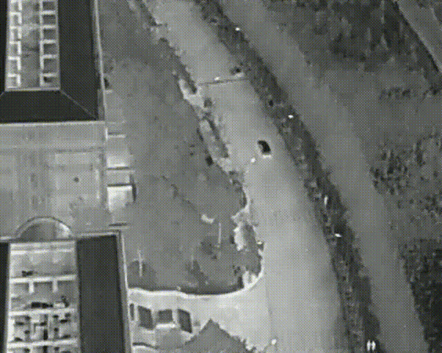

# SKY-IR: High-Altitude Infrared Thermal Object Tracking for UAV


Hệ thống phát hiện và theo dõi đa đối tượng trên video nhiệt/hồng ngoại quay từ UAV ở độ cao lớn.
YOLOv8 (backbone EfficientNet-B0) để phát hiện, **SkyTrack** (họ ByteTrack/BoT-SORT, tối ưu cho mục tiêu nhỏ)
để theo dõi, có bù chuyển động camera (GMC) và ước lượng cự ly mặt đất.



## Kết quả tối ưu

Đo trên RTX 3050 Laptop (4 GB), video 640×512 (`backend/scripts/benchmark.py`):

| | Trước | Sau |
|---|---|---|
| Inference model | 29.1 ms (PyTorch FP32) | **8.6 ms** (TensorRT FP16, tiền/hậu xử lý trên GPU) |
| Toàn pipeline (decode → detect → GMC → track) | 37.2 ms · 27 FPS | **9.7 ms · 103 FPS** |
| Không có TensorRT (PyTorch FP16) | – | 54 FPS |
| Xuất video | mp4v + ffmpeg encode lại lần 2 | H.264 trực tiếp, ~82 FPS |

Tracker so với bản cũ trên 5 video mẫu, cùng một bộ detection (`backend/scripts/eval_tracker.py`; chưa có ground truth nên dùng chỉ số thay thế):

| | Tracker cũ (SORT + IoU) | SkyTrack |
|---|---|---|
| Số ID tạo ra (ít hơn = ít phân mảnh) | 236 | **204** |
| "Re-birth": ID mới xuất hiện ngay chỗ ID cũ vừa mất (≈ ID switch) | 29 | **7** |
| Độ phủ detection tin cậy cao | 94.7 % | **97.1 %** |
| Độ dài track trung bình (frame) | 76.6 | **87.1** |

> Có file ground truth MOT thì upload ở mục *Xuất kết quả* để có MOTA / IDF1 / ID Sw thật.

## Những gì đã thay đổi

**Inference**
- Sửa lỗi: app cũ trỏ tới `models/best.pt` (không tồn tại) nên *âm thầm* chạy `yolov8n.pt` COCO thay vì model đã train.
- Model chỉ nạp một lần và được cache (bản cũ nạp lại mỗi lần bấm nút).
- Tự export TensorRT FP16 ở lần chạy đầu (~2–3 phút), input 512×640 khớp với khung hình nên không phải pad lên 640×640.
- Runner TensorRT riêng: upload frame qua pinned memory, letterbox/normalize và decode + NMS chạy trên GPU.
- GMC (optical flow, CPU) chạy song song với detect (GPU); đọc video bằng thread prefetch riêng.

**Tracking (SkyTrack, `backend/skyir/tracker/`)**
- Kalman filter vector hoá cho mọi track, trạng thái (cx, cy, w, h); nhiễu tỉ lệ theo kích thước nhưng có sàn tối thiểu theo pixel, nên không quá tự tin với mục tiêu 5–15 px.
- GMC biến đổi cả vị trí, kích thước, vận tốc và hiệp phương sai (bản cũ chỉ dời tâm). Góc đặc trưng được che ở vùng có đối tượng để vật chuyển động không làm lệch ước lượng.
- Ghép bằng *buffered IoU* (C-BIoU) kết hợp khoảng cách tâm: mục tiêu 8 px dịch 9 px giữa 2 frame có IoU = 0, nhưng vẫn ghép đúng.
- Ghép 3 tầng kiểu ByteTrack (detection cao → thấp → track chưa xác nhận); track bị mất vẫn được ghép lại trong `track_buffer` giây, và vận tốc giảm dần khi mất dấu.
- Lớp đối tượng được bầu theo độ tin cậy (chống nhảy lớp Person/Bicycle), ID tính riêng cho từng phiên.
- Khoá mục tiêu ở bất kỳ frame nào. Mục tiêu đã khoá được giữ lâu gấp 3 lần và hiển thị vị trí dự đoán khi tạm mất dấu.

**Giao diện (React + TypeScript, thay Gradio)**
- Stream thời gian thực qua WebSocket. Overlay vẽ trên canvas phía trình duyệt nên đổi kiểu hiển thị tức thì, không phải xử lý lại.
- Bấm trực tiếp vào đối tượng để khoá/bỏ khoá. Ô phóng to mục tiêu khoá (mục tiêu nhiệt chỉ vài pixel), có vệt di chuyển được bù chuyển động camera.
- Mọi tham số detect/track/camera áp dụng ngay khi đang chạy. Có các bảng màu nhiệt White-hot, Black-hot, Ironbow, Arctic, Rainbow.
- Bảng đối tượng (lớp, độ tin cậy, cự ly, tuổi), bảng hiệu năng từng giai đoạn, xuất MP4 + `tracks.txt` (MOT) + metrics.
- Tự điền độ cao/pitch từ tên file kiểu HIT-UAV (`60m-40_3.mov` → 60 m, 40°).
- Phím tắt: `Space` phát/dừng · `→` từng frame · `R` chạy lại · `Esc` bỏ khoá.

**Vì sao không chuyển backend sang Rust:** theo profile, 85 % thời gian là inference trên GPU, còn tracking chỉ ~1 ms/frame.
Viết lại bằng Rust không làm GPU chạy nhanh hơn mà lại mất hệ sinh thái Ultralytics/TensorRT/OpenCV của Python.

## Cấu trúc

```text
backend/
  skyir/
    detector.py        TensorRT runner + PyTorch fallback, tự build engine
    pipeline.py        Session: prefetch decode, detect ‖ GMC, track, cự ly
    tracker/           SkyTrack: kalman.py, matching.py, gmc.py, tracker.py
    distance.py        Ước lượng cự ly mặt đất / đường chéo
    export.py          Xuất H.264, tracks MOT, MOTA/IDF1
    render.py          Vẽ overlay cho video xuất
    server.py          FastAPI: REST + WebSocket /api/stream
  scripts/
    benchmark.py       So sánh tốc độ các backend
    eval_tracker.py    So sánh tracker cũ và mới
    legacy/            Tracker cũ (giữ lại làm baseline)
  tests/               Unit test tracker
frontend/              React + TypeScript + Vite
models/                Trọng số .pt (engine .engine sinh tự động)
run.sh                 Chạy / dev / test
```

## Cài đặt

```bash
git clone https://github.com/Astrq23/SKY-IR.git && cd SKY-IR

# Python 3.10–3.12
python -m venv .venv && source .venv/bin/activate
pip install torch torchvision --index-url https://download.pytorch.org/whl/cu128
pip install -r requirements.txt

# Frontend (Node 18+)
cd frontend && npm install && cd ..
```

Tải trọng số vào `models/`: https://drive.google.com/drive/folders/1u7Ez44U2t3bCcb2YwpMhcN_xASYZbMUV?usp=sharing
Video mẫu đặt trong `models/` hoặc `data/samples/`; có thể tải thêm video trực tiếp trên giao diện.

## Chạy

```bash
./run.sh            # build UI nếu cần, mở http://127.0.0.1:8000
./run.sh dev        # backend :8000 + Vite hot-reload :5173
./run.sh test       # unit test

HOST=0.0.0.0 ./run.sh   # mở cho máy khác trong mạng LAN truy cập
```

Lần chạy đầu sẽ build TensorRT engine (~2–3 phút). Engine phụ thuộc GPU và phiên bản TensorRT, nên khi đổi máy chỉ cần xoá file `.engine` để build lại.
Không có TensorRT thì hệ thống tự dùng PyTorch FP16.

Đo đạc:

```bash
python backend/scripts/benchmark.py models/60m-30_1.mov
python backend/scripts/eval_tracker.py models/*.mov
```

## Đóng góp
1. Nguyễn Hoàng Việt: gán nhãn dữ liệu đánh giá; thuật toán theo dõi (GMC, Kalman); giao diện; tài liệu.
2. Nguyễn Thừa Tuân: nghiên cứu và lựa chọn YOLOv8 cho video nhiệt; tối ưu pipeline GPU; tài liệu.
3. Nguyễn Quang Việt: tích hợp motmetrics; thử nghiệm và đánh giá trên dữ liệu UAV nhiệt; báo cáo.
